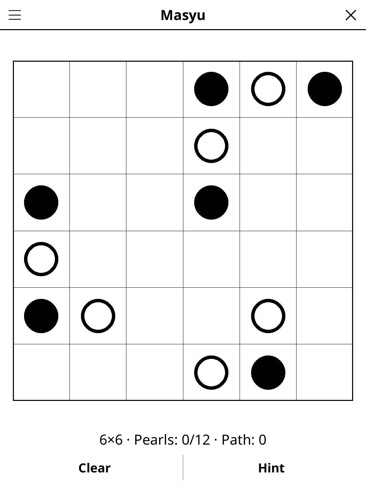

# masyu.koplugin

A Masyu puzzle plugin for [KOReader](https://github.com/koreader/koreader).

## Screenshot

## Rules

Draw a single closed loop passing through all pearl circles. **White pearl**: the loop goes straight through and must turn in at least one adjacent cell. **Black pearl**: the loop turns 90° here and must go straight through both adjacent cells. The loop cannot branch or cross itself.

## Features

- **Two grid sizes** — 6×6, 8×8
- **Hint** — two taps, working in the loop rather than cells
- **No guessing** — every puzzle is solvable by logic alone, with one solution
- **Reveal solution** — show the generated loop at any time
- **Auto-save** — puzzle state saved and restored on next launch

## Installation

1. Download `masyu.koplugin.zip` from the [latest release](../../releases/latest).
2. Extract into the `plugins/` folder of your KOReader data directory.
3. Restart KOReader.
4. Open the menu → **Tools** → **Masyu**.

## Controls

| Action | How |
|--------|-----|
| Toggle a cell in/out of the loop | Tap it |
| Reveal / hide the solution | Tap **Show solution** / **Hide solution** |
| Clear your path | Tap **Clear** |
| New puzzle | Tap **New game** |
| Change grid size | Tap **Size** |
| Show rules | Tap **Rules** |

## Puzzle quality

Every generated puzzle has exactly one solution and can be solved by
reasoning alone: the generator only keeps a puzzle that its built-in solver
finishes without ever guessing (circle rules, edges and corners, no loop
closing early, the loop staying in one piece).

## License

GPL-3.0 — see [LICENSE](LICENSE).
